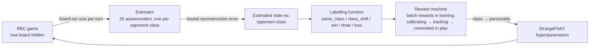

# GRM-RBC: Generative Reward Machines for Reconnaissance Blind Chess

This repository contains the **training and implementation of uccchess**, the University College Cork entry in the NeurIPS 2022 Reconnaissance Blind Chess (RBC) tournament. The tournament, its bots and its results are described in:

> R. W. Gardner, G. Perrotta, A. Shah, S. Kalyanakrishnan, K. A. Wang, G. Clark, T. Bertram, J. Fürnkranz, M. Müller, B. P. Garrison, P. Dasgupta and **S. Rezaei**.
> *The Machine Reconnaissance Blind Chess Tournament of NeurIPS 2022.* Proceedings of the NeurIPS 2022 Competitions Track, PMLR 220:119–132, 2023.
> **https://proceedings.mlr.press/v220/gardner23a.html**

uccchess is built on [StrangeFish2](https://github.com/ginoperrotta/reconchess-strangefish2), the tournament winner. A **Generative Reward Machine (GRM)** recognises what kind of opponent the bot is facing and selects the StrangeFish2 hyperparameters that work best against it.

The method is developed in Chapter 4 of the PhD thesis *Generative Reward Machines for Reinforcement Learning in Problems with Poor Observability* (S. Rezaei, University College Cork). This repository also contains the Q-learning baseline from that chapter. That baseline was entered in the same tournament as **srcork**.

---

## Contents

- [The idea of the Generative Reward Machine](#the-idea-of-the-generative-reward-machine)
- [The GRM for Reconnaissance Blind Chess](#the-grm-for-reconnaissance-blind-chess)
- [uccchess in the NeurIPS 2022 tournament](#uccchess-in-the-neurips-2022-tournament)
- [Repository layout](#repository-layout)
- [Installation](#installation)
- [Pipeline: from training to the tournament bot](#pipeline-from-training-to-the-tournament-bot)
- [Configuration](#configuration)
- [Outputs](#outputs)
- [Compute budget](#compute-budget)
- [Tests](#tests)
- [Changes to StrangeFish2](#changes-to-strangefish2)
- [Citation](#citation)
- [License](#license)

---

## The idea of the Generative Reward Machine

### The problem

Reinforcement learning (RL) needs a reward signal that means the same thing every time the agent is in the same situation. Many real problems break this assumption:

- **The state is only partly observed.** The agent sees an observation, not the true state.
- **Feedback is very noisy.** One episode's outcome depends on chance as much as on the agent's choice.

The thesis calls these the *hard* problem class. In this class the reward the agent receives for the same observed situation changes from episode to episode. Standard RL then struggles to converge, and an optimal policy over the raw observations may not exist at all.

**Reward machines** (Icarte et al.) help RL by exposing the structure of the reward function. A reward machine is a finite-state machine:

1. a labelling function turns environment transitions into propositional events;
2. the events move the machine between states;
3. each machine state has its own reward function.

Learning over the joint (environment state, machine state) space makes many non-Markovian tasks Markovian. This only works, however, if those events can be read reliably from the **true** environment state. In a partially observed, noisy problem they cannot.

### What the GRM changes

The GRM keeps the reward-machine structure but moves it from the true state to an **estimated state** that the GRM itself builds. It has two parts:

1. **An estimator or mapping function.** It turns noisy, partial observations into a small, stable, designed state space *E*. It can be a direct mapping into predefined states, or a learned estimator, such as a classifier.
2. **A specialised reward machine on that space.** Its labelling function, state transitions and reward functions are all defined on transitions in *E*, not in the true state space.

The machine is called *generative* because it generates this intermediate state space and the reward signal attached to it. It uses whatever limited knowledge of the problem is available, so that rewards for the same estimated situation stay stationary even though the underlying environment does not. The aim is to approximate a reward machine that makes the problem Markovian over (estimated state, machine state), in cases where no exact reward machine exists.

| Component | Reward machine | Generative reward machine |
|---|---|---|
| State basis | True environment states *S* (or observations) | Designed, estimated states *E* derived from observations |
| Reward function | On transitions *S × A × S* | On transitions *E × A × E* |
| Labelling function | Events from true transitions | Events from transitions in the estimated space |
| Truth assignment | Read from the true state | Read from the estimated state |
| Goal | Markovian problem over *S × U* | Approximately Markovian, tractable problem when the true state is unavailable |

### One step of an agent using a GRM

1. The environment is in a true state *ts*, which the agent cannot see.
2. The agent receives a partial observation *os*.
3. The estimator maps the observation (and the history) to an estimated state *es*.
4. The GRM is in machine state *u*, which has its own reward function *r_u*.
5. The agent chooses an action *a*.
6. The environment moves to *ts′* and the agent observes *os′*.
7. The estimator computes *es′* from *es*, *a* and *os′*.
8. The reward *r_u* is computed on the estimated transition *es → es′*.
9. The labelling function emits the symbols that describe this transition.
10. The symbols move the machine from *u* to *u′*.
11. The process repeats from (*ts′*, *os′*, *es′*, *u′*).

## The GRM for Reconnaissance Blind Chess

**RBC** ([rules](https://rbc.jhuapl.edu/gameRules)) is chess in which you cannot see the opponent's pieces. Each turn a player senses a 3×3 window of the board and then moves. It learns where its own pieces were captured and what its own move actually did, and nothing else. It is a clear example of the hard class: the true board is hidden, the opponent is unknown, and single games are extremely noisy.

**StrangeFish2** keeps the set of every board consistent with its observations (multiple-hypothesis tracking). It chooses sense and move actions by scoring them across that set with Stockfish. How it plays depends on hyperparameters, for example:

| Parameter | Effect |
|---|---|
| `max_score_factor` | Aggressiveness: weight of a move's best-case outcome |
| `threshold_score` | Unpredictability: any move within this many centipawns of the best may be played |
| `sampling_exploration_coef` | Exploration: UCT bonus for evaluating rarely sampled moves |
| `min_score_factor`, `mean_score_factor` | Caution and solidity |
| `boards_per_centipawn`, `worst_outcome_coef`, ... | How sensing trades information gain against move quality |

No single setting is best against every opponent. The GRM learns which setting to use against which opponent.



| GRM element | In RBC (this repository) |
|---|---|
| Observation *os* | The bot's own uncertainty over the game: the size of its board set at the start of each turn, after sensing and after moving (`grm_rbc/belief.py`). |
| Estimator → *es* | A bank of 20 autoencoders, one per opponent class (Stockfish `Skill Level` 1–20). Each is trained only on games against its class. The class whose autoencoder reconstructs the current game best is *es* (`grm_rbc/estimator.py`). |
| Action *a* | A *personality*: a full vector of StrangeFish2 hyperparameters (`grm_rbc/personalities.py`). |
| Labelling function | `win`, `draw`, `loss` or `forfeit` at game end; `same_class` or `class_shift` between turns (`grm_rbc/grm.py`). |
| Reward machine (training) | While *collecting*, the machine stores game outcomes and emits nothing. After 100 games against one class it moves to *emit* and returns the mean outcome (win +1, draw 0, loss −1). Averaging over a batch removes the noise that makes single-game rewards non-stationary. |
| Policy learning (Algorithm 3) | `Q(s, a)` is the mean of all batch rewards for (class, personality); the policy is `argmax_a Q(s, a)` (`scripts/train_grm_policy.py`). |
| Reward machine (play) | *Calibrating* for the first turns (default personality), then *tracking* the estimated class. Once the estimate is confirmed it is *committed* and switches to the learned personality. It is *frozen* under time pressure. On each estimated transition it generates `Q(es′, current personality)` (`grm_rbc/grm.py`, `grm_rbc/grm_bot.py`). |

**Q-learning baseline (Algorithm 2, srcork).** The state is (colour, opening): five opening lines per colour plus "other". The action is a personality, the reward is the outcome of a single game, and the update is `Q ← Q + α(R − Q)` (`grm_rbc/baseline.py`). The baseline has neither the estimator nor the batch reward, which makes it a direct test of what the GRM adds.

## uccchess in the NeurIPS 2022 tournament

The tournament paper ([PMLR 220:119–132](https://proceedings.mlr.press/v220/gardner23a.html)) describes uccchess as follows:
- It is based on StrangeFish and uses a set of 20 neural networks.
- Each turn it evaluates the game history and matches the opponent to one of 20 classes, which correspond to those networks.
- The class determines how StrangeFish's scores are computed.
- The class is selected by an agent trained with reinforcement learning, using matches against predefined bots as the reward signal.

This repository is that pipeline, in the form detailed in the thesis:
- the 20 networks are the class autoencoders of the estimator;
- the RL agent is the GRM trained with batch rewards against predefined skill-level bots;
- the class it identifies selects the StrangeFish2 hyperparameters used for scoring.

| Bot | Method | Rating in the tournament |
|---|---|---|
| uccchess | GRM (Algorithm 3) | Bayes Elo 1025, rank 14, including forfeits (paper, Table 2) |
| uccchess | GRM (Algorithm 3) | Average Elo 1365, excluding forfeits (thesis, Table 4.2) |
| srcork | Q-learning (Algorithm 2) | Average Elo 1190, excluding forfeits (thesis, Table 4.2) |

The paper reports that forfeits from crashes and connection problems significantly lowered the ratings of uccchess and srcork. It also reports two measures for uccchess: a median of 21 possible boards over a game, and agreement with Stockfish's choice on 58% of moves.

The run-time protections in this code target exactly those failure modes:
- each game runs in its own process;
- engine memory is bounded;
- an internal StrangeFish2 assertion is handled;
- the server connection retries on errors.

## Repository layout

```
grm-rbc/
├── uccchess/                     THE TOURNAMENT BOT (self-contained folder, see uccchess/README.md)
│   ├── uccchess_bot.py           UCCChess agent and tournament configuration loader
│   ├── tournament_config.json    hyperparameters of every personality, class → personality table,
│   │                             run-time rules and engine settings used in tournament games
│   ├── models/                   estimator checkpoint used by the bot
│   ├── play_local_game.py        local game against a reconchess baseline bot
│   └── connect_server.py         play on rbc.jhuapl.edu
├── grm_rbc/                      the method
│   ├── grm.py                    labelling function, batch reward machine, GRM policy, run-time GRM
│   ├── estimator.py              autoencoder bank, reconstruction errors, decision rules, inference
│   ├── estimator_training.py     data loading, batching, training and evaluation of the estimator
│   ├── belief.py                 board-set-size traces and their encoding
│   ├── personalities.py          the action space (named personalities or a hyperparameter grid)
│   ├── grm_bot.py                GRMStrangeFish: StrangeFish2 with recording, estimation and switching
│   ├── baseline.py, openings.py  Q-learning baseline over (colour, opening)
│   ├── opponents.py              Stockfish skill-level opponents and reconchess baselines
│   ├── game_runner.py            parallel local games (one process per game)
│   ├── remote.py                 server connection
│   └── common.py                 logging, seeding, run folders, file helpers
├── scripts/
│   ├── generate_traces.py        1. record board-set traces against every opponent class
│   ├── train_estimator_cuda114.py   2. train the estimator (PyTorch < 1.10, CUDA 11.4)
│   ├── train_estimator_cuda122.py   2. train the estimator (PyTorch 2.x, CUDA 12.2)
│   ├── train_grm_policy.py       3. train the GRM (Algorithm 3) or the Q-learning baseline (Algorithm 2)
│   ├── evaluate.py               4. compare bots against a set of opponents
│   ├── export_tournament_bot.py  5. write uccchess/tournament_config.json from a training run
│   ├── play_local.py             one game with a full account of every GRM step
│   ├── connect_server.py         play any trained variant (grm / fixed / opening_q) online
│   ├── install_stockfish.sh      download Stockfish
│   └── check_installation.py     verify the environment
├── strangefish/                  StrangeFish2 (vendored, see "Changes to StrangeFish2")
├── tests/                        unit tests (test_components.py needs no Stockfish)
├── INSTALL.md                    installation guide
├── environment-cuda122.yml, environment-cuda114.yml, environment-cpu.yml   conda environments
├── requirements*.txt, pyproject.toml                                       pip installation
├── LICENSE                       MIT (grm_rbc, uccchess, scripts, tests)
└── LICENSE-STRANGEFISH2          BSD-3-Clause (strangefish)
```

Every file starts with a description of what it contains, and every class, function and method has a docstring.

## Installation

The full guide is in [INSTALL.md](INSTALL.md). In short:

```bash
conda env create -f environment-cuda122.yml && conda activate grm-rbc-cu122   # or -cuda114 / -cpu
pip install -e .
bash scripts/install_stockfish.sh
export STOCKFISH_EXECUTABLE=$PWD/engines/stockfish
python scripts/check_installation.py
```

## Pipeline: from training to the tournament bot

Every training script starts with a single `CONFIG` dictionary that holds all its options. The alternatives for each option are written next to it. Edit CONFIG and run the script. Each run writes everything into its own time-stamped folder under `runs/`.

### 1. Record belief traces

```bash
python scripts/generate_traces.py
```

This plays the bot against Stockfish opponents at every skill level in `levels` (default 1–20), `games_per_level` games each, and appends one JSON line per finished game to `traces.jsonl`. If a run is interrupted, set `resume_dir` to its folder to continue it. At the end, `summary.json` lists games, results, game length and peak board-set size per level.

### 2. Train the estimator

```bash
python scripts/train_estimator_cuda122.py     # PyTorch 2.x
python scripts/train_estimator_cuda114.py     # PyTorch < 1.10 (float16 autocast without a dtype argument)
```

Set `trace_files` to the output of step 1. `gpu_ids` selects the GPUs:
- `[]` runs on the CPU;
- `[0]` uses one GPU;
- `[0, 1, 2, 3]` sets `CUDA_VISIBLE_DEVICES` and trains with `DataParallel`.

Data loading, the architecture (`gru`, `mlp`, `conv1d`), the loss, the optimiser, the scheduler and the decision rule are all selected in CONFIG. The script stops if a trace file is missing or empty, or if any class has no training or validation games.

After every epoch it saves:
- the checkpoint;
- the validation predictions;
- the confusion matrix;
- a report row with accuracy on full games and on game prefixes.

The best epoch is copied to `estimator.pt`.

### 3. Train the GRM policy

```bash
python scripts/train_grm_policy.py
```

**With `algorithm = "grm"` (default, Algorithm 3):** each episode picks an opponent class (`state_selection`) and a personality (`action_selection`: `ucb1`, `epsilon_greedy` or `round_robin`). It plays `games_per_batch` games and updates `Q` through the batch reward machine.

There are two ways to credit a batch:
- `state_source = "true_level"` credits the batch to the class that was played, as in the thesis;
- `"estimated"` credits each game to the estimator's class at game end, so the table is learnt in exactly the state space the bot sees when playing.

**With `algorithm = "qlearning"`:** this trains the srcork baseline (Algorithm 2) instead.

After every episode the script saves the learner state, the greedy policy, the Q-table and the games. `policy.json` holds the latest state. To continue a run, set `resume_from`.

### 4. Evaluate

```bash
python scripts/evaluate.py
```

This plays the GRM bot, plain StrangeFish2 settings and the Q-learning baseline against the same opponents. It writes `summary.csv` with, for each bot and opponent:
- wins, draws, losses and errors;
- score;
- the estimator's accuracy at the end of each game;
- when the first switch happened;
- the personalities the bot finished with.

To follow one game turn by turn, use `python scripts/play_local.py`.

### 5. Set the tournament hyperparameters

```bash
python scripts/export_tournament_bot.py
```

Set `policy` and `estimator` in its CONFIG first. The script resolves the learned class → personality table into explicit StrangeFish2 hyperparameters, writes them to `uccchess/tournament_config.json`, and copies the estimator into `uccchess/models/`. The bot folder is then complete. You can review or adjust the JSON before a tournament.

### 6. Play

```bash
python uccchess/play_local_game.py                          # local game against TroutBot
python uccchess/connect_server.py <username> <password>     # online, add --ranked for Elo games
```

## Configuration

Options worth tuning first:

| Where | Option | Notes |
|---|---|---|
| traces / policy | `game.seconds_per_player`, `base_overrides.score.search_depth` | Shorter clocks and depth 5–6 make data collection much faster. |
| traces | `our_personalities` | `["default"]` matches what the bot plays before its first estimate. Use `"all"` to train the estimator on every personality. |
| estimator | `arch`, `encoding.feature_mode`, `prefix_augmentation` | The default is a GRU on all three counts per turn, trained on game prefixes. |
| estimator | `decision_rule` | `raw` (lowest error, the thesis rule) or `zscore` (per-model standardised error). |
| policy | `action_space` | `named` has 8 interpretable personalities. `grid` has 27 points over the three key parameters, plus `default`. |
| policy | `games_per_batch`, `episodes` | The thesis uses 100 games per batch. |
| bot | `runtime.warmup_turns`, `confirm_turns`, `switch_margin` | Trade off acting early on a weak estimate against switching late. |

## Outputs

```
runs/
├── traces_<time>/          traces.jsonl, summary.json, config.json, log.txt
├── estimator_cuda122_<time>/
│   ├── epoch_001/ ...      estimator.pt, val_predictions.csv, confusion_matrix.csv
│   ├── estimator.pt        best epoch
│   └── training_report.csv / .json, config.json, log.txt
├── policy_grm_<time>/
│   ├── episode_0001/ ...   policy_state.json, greedy_policy.json, q_table.csv, games.csv
│   ├── policy.json         latest learner state
│   └── action_space.json, games.jsonl, training_report.csv, config.json, log.txt
└── evaluation_<time>/      results.jsonl, summary.csv, summary.json, config.json, log.txt
```

## Compute budget

Games are CPU-bound, because both sides run Stockfish, and each game runs in its own process. A good value for `workers` is about half the number of CPU cores.

The full pipeline needs roughly:
- traces: 20 levels × 60 games, about 1,200 games;
- GRM policy: 160–320 batches × 100 games, about 16,000–32,000 games.

At 180 s per side and depth 6, a game takes 1–4 minutes. The estimator trains in minutes.

## Tests

```bash
python -m pytest -q
```

`tests/test_components.py` covers the following, and needs no Stockfish:
- personalities and openings;
- the labelling function, batch reward machine, GRM policy and run-time GRM;
- the Q-learning baseline;
- trace encoding;
- all three autoencoder architectures, with a save/load round trip.

`tests/test_tournament_bot.py` checks the uccchess tournament configuration and its policy table. It runs when `STOCKFISH_EXECUTABLE` is set, because importing the bot imports StrangeFish2. No engine is started.

## Changes to StrangeFish2

`strangefish/` is StrangeFish2 as published at <https://github.com/ginoperrotta/reconchess-strangefish2>, with one change. In `sense_min_states` the board set is converted to a tuple before `random.sample`, because Python 3.11 and later no longer sample from sets.

Everything else is added by subclassing in `grm_rbc/grm_bot.py`:
- belief recording;
- estimator calls;
- personality switching;
- forced opening lines.

The subclass also handles four details that matter when many games run without StrangeFish2's 2022 opening book and score cache:

- **Engine size.** The engine is created with the configured threads and hash. StrangeFish2 itself reserves 3 threads and 2 GB per game.
- **Board priorities.** Every board gets a sampling priority before sensing and moving. Without one, White's first turn can trip an internal assertion in the move sampler.
- **Fresh config objects.** Each game gets new config objects, because the time-pressure plan modifies them in place.
- **Time pressure.** Personalities stop changing once the time-pressure plan is active.

## Citation

If you use this code, please cite the tournament paper and the thesis:

```bibtex
@inproceedings{gardner2023rbc,
  author    = {Gardner, Ryan W. and Perrotta, Gino and Shah, Anvay and Kalyanakrishnan, Shivaram and
               Wang, Kevin A. and Clark, Gregory and Bertram, Timo and F{\"u}rnkranz, Johannes and
               M{\"u}ller, Martin and Garrison, Brady P. and Dasgupta, Prithviraj and Rezaei, Saeid},
  title     = {The Machine Reconnaissance Blind Chess Tournament of {NeurIPS} 2022},
  booktitle = {Proceedings of the NeurIPS 2022 Competitions Track},
  series    = {Proceedings of Machine Learning Research},
  volume    = {220},
  pages     = {119--132},
  year      = {2023},
  url       = {https://proceedings.mlr.press/v220/gardner23a.html}
}

@phdthesis{rezaei2026grm,
  author = {Saeid Rezaei},
  title  = {Generative Reward Machines for Reinforcement Learning in Problems with Poor Observability},
  school = {University College Cork},
  year   = {2026},
  url    = {https://cora.ucc.ie/items/6cf46796-173c-4426-99bd-676e11656485}
}
```

Please also cite StrangeFish2 (Gino Perrotta, 2022) as described in its repository.

## License

- `grm_rbc/`, `uccchess/`, `scripts/` and `tests/`: MIT (see `LICENSE`).
- `strangefish/`: BSD-3-Clause, © The Johns Hopkins University Applied Physics Laboratory LLC and the original StrangeFish authors (see `LICENSE-STRANGEFISH2`).

## Acknowledgements

- StrangeFish and StrangeFish2 by Gino Perrotta, Robert Perrotta and Taylor Myers.
- The `reconchess` package and the RBC server by JHU/APL.
- This work was carried out at University College Cork under the supervision of Prof. Kenneth N. Brown and Prof. Barry O'Sullivan.
